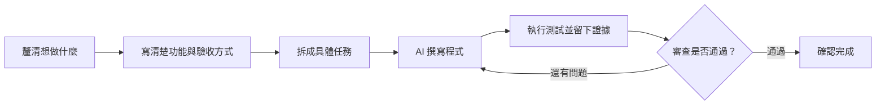

<!--
document_title: Software Development Assurance Harness
chinese_title: AI 寫的程式，驗過才算數
aka: [Coding Audit Harness]
established_date: 2026-09-29
updated_date: 2026-10-26
version: 3.2.0
-->

# Software Development Assurance Harness

### AI 寫的程式，驗過才算數

**讓 AI 開發的軟體，在說「完成」之前，先拿出可以檢查的證據。**

*An evidence-driven harness for AI-assisted software development, integrating structured workflows, stage-level audits, executable verification, and UI quality assurance.*

**繁體中文** · [简体中文](README.zh-CN.md) · [English](README.en.md) · [Français](README.fr.md) · [Latina](README.la.md)

[這是什麼？](#這是什麼) · [實際例子](#用一個實際例子理解) · [可以做什麼](#它能幫你做到什麼) · [如何開始](#我不會寫程式也能用嗎) · [技術文件](#給想實際安裝的人)

---

## 這是什麼？

你請 AI 幫忙製作一個網站、工具或小遊戲。過一陣子，AI 說：「做好了，測試也通過。」

但你可能還是不知道：

- 網站真的能正常使用嗎？
- 它有沒有漏掉你一開始提出的要求？
- 測試是在**哪個版本**的程式上做的？如果 AI 後來改了程式，結果還有效嗎？
- 出現問題時，有沒有記錄原因，還是只會一直說「我修好了」？

**Software Development Assurance Harness（簡稱 SDAH）** 就是用來處理這些問題的開發輔助工具。它把 AI 開發軟體的過程分成可檢查的步驟，要求每個重要的「通過」都留下紀錄，讓你知道哪些事情真的驗證過、哪些還沒有。

你可以把它想成一套**給 AI 開發團隊使用的工作流程與驗收規則**：AI 負責提出方案和撰寫程式；這套工具負責檢查必要的測試紀錄與流程是否齊全；最後仍由人判斷結果是否符合需求。

> 它本身不是 ChatGPT、不是會自動寫出整套軟體的 AI，也不是按一個按鈕就能完成開發的網站。它需要配合能讀取檔案、執行指令的程式開發代理（Coding Agent）使用。

## 用一個實際例子理解

假設你是一位老師，希望 AI 做一個**英文報時練習網頁**。你希望學生能答題、看到對錯回饋、使用計時器，最後看到成績與錯題。

| 沒有明確驗收流程 | 使用 SDAH 協助把關 |
| --- | --- |
| AI 說「全部功能完成」 | 先把每項要求寫成可以逐項檢查的條件 |
| AI 說「測試通過」 | 由工具執行已定義的測試，保存結果與當時的程式版本紀錄 |
| AI 說「畫面沒問題」 | 可另外收集瀏覽器截圖、鍵盤操作和錯誤訊息，供檢查 |
| 修改程式後沿用舊的測試結論 | 程式或計畫有重要變更時，舊證據不能直接當作新版本的通過證明 |
| 出錯後反覆修改，難以追蹤 | 留下問題、修正與再次驗收的紀錄 |

這個儲存庫有一個內建的英文報時遊戲案例，用來驗證上述開發與審查流程。但**案例通過不代表所有用這套工具做的網站都通過驗收**。

## 它怎麼運作？

這個流程裡有三個不同的角色：**AI 開發代理**負責產出規格和程式；**驗證工具**負責執行設定好的檢查並保存結果；**你或負責審查的人**決定需求、設計和最終品質是否可接受。

其中有些檢查是程式能自動判定的，例如某個按鈕是否會正確計算分數；有些則仍需要人判斷，例如介面是否易懂、練習難度是否適合學生。

## 它能幫你做到什麼？

| 能力 | 用一般話來說 |
| --- | --- |
| **開發流程管理** | 知道目前是在討論需求、安排工作、撰寫程式，還是審查成果 |
| **逐階段檢查** | 每個重要階段都有要確認的內容，不是 AI 說可以就直接往下做 |
| **保留測試證據** | 記錄跑了哪些檢查、成功或失敗，以及對應哪一版程式 |
| **問題與修正追蹤** | 沒處理完的重要問題會阻止工作直接標示為完成 |
| **介面品質輔助檢查** | 對網頁／介面專案，能收集截圖、瀏覽器錯誤、鍵盤操作等證據 |

目前提供的是**命令列驗證核心（Runner）**，以及可選用的 **UI 檢查工具包（UI Pack）**。單純寫程式的專案和包含網站介面的專案，可以採用不同的檢查流程。

## 我不會寫程式，也能用嗎？

**可以理解它、用它來要求 AI 提供更完整的驗收紀錄；但實際設定仍需要一點技術協助。** 目前沒有給一般使用者直接點選操作的圖形介面，也沒有自動安裝所有環境的一鍵設定。

如果你平常使用 Codex、OpenCode 或其他能操作專案檔案與終端機的 Coding Agent，可以將這個專案交給它，先要求它說明安裝條件和每個需要你核准的步驟。

你可以用下面這段話作為起點（將方括號內換成自己的需求）：

> 我想製作「[簡單描述你的網站、工具或小遊戲]」。請先閱讀這個儲存庫的 `README.md`、`docs/TECHNICAL_GUIDE.md` 與 `AGENTS.md`，協助我評估如何使用 Software Development Assurance Harness。先將需求整理成清楚的驗收條件，告訴我需要準備哪些環境、哪些檢查可以自動進行，以及哪些決策需要我親自確認。不要跳過測試，也不要在沒有證據時宣稱全部完成。

實際使用通常需要 **Python 3.12**、必要的套件，以及可執行命令的電腦環境；需要檢查網頁畫面時，還要準備 Playwright 和 Chromium。安裝步驟與指令請見 [完整技術操作指南](docs/TECHNICAL_GUIDE.md#安裝)。

## 哪些事不能交給它保證？

- **不能保證 AI 寫的程式一定正確。** 它只能檢查已明確定義的驗收項目；漏掉的需求仍可能沒被發現。
- **不能取代你的最終判斷。** 需求是否真的合用、畫面是否美觀或適合使用者，仍需要人審查。
- **不能把截圖當成完整的介面品質認證。** 目前沒有因此證明所有瀏覽器、所有手機、真人可用性或完整無障礙標準都合格。
- **不是資安沙箱。** 它能阻擋一些過期證據與操作流程錯誤，但不能防止擁有相同電腦權限的人惡意修改檔案或紀錄。
- **沒有內建的 AI 聊天介面或多人協作平台。** 規劃中的 Audit Console 目前尚未推出。

## 目前驗證到什麼程度？

截至 **2026 年 10 月 26 日**的 V2.1 里程碑，已在 GitHub Actions 取得下列結果：

- Windows、Ubuntu：各 **201 項自動化回歸測試通過**。
- Ubuntu Chromium：內建英文報時遊戲的 **37 項完整流程檢查通過**，並保存測試紀錄和瀏覽器證據。
- 歷史版本的 SHA-256 對照**未執行**；跨瀏覽器、真人操作及輔助科技測試也不在這次驗收範圍內。

你可以查看 [實際 CI 紀錄](https://github.com/weiwei-alvin/software-development-assurance-harness/actions/runs/40321649292) 與 [V2.1 驗證說明](docs/releases/2026-10-26-v2-1-assurance.md)，不必只相信上面寫的「通過」。

## 給想實際安裝的人

如果你是開發者，或者準備請 Coding Agent 幫你設定，可以從下列文件開始：

- [完整技術操作指南](docs/TECHNICAL_GUIDE.md)：原版 README 的完整操作、命令、設定與安全說明。
- [UI Pack 使用說明](packs/ui/README.md)：用在網站或介面專案的額外驗收與證據收集。
- [五階段與稽核流程相關 Skills](skills/)：可供 Coding Agent 使用的規則與上游開發技能。
- [版本變更紀錄](docs/CHANGELOG.md) 與 [V2.1 發版說明](docs/releases/2026-10-26-v2-1-assurance.md)。
- [尚未推出的功能](docs/DEFERRED_ITEMS.md)：包含圖形化操作介面與部分協作功能。

其他語言的 README 仍保留技術導向內容；**繁體中文首頁是這次面向一般讀者的改寫版本**。

---

## 授權與致謝

本專案原創部分採用 [MIT License](LICENSE)。上游整合的 Matt Pocock 技能保留原授權與來源資訊，詳見 [授權](skills/matt-upstream/LICENSE)及[上游版本記錄](skills/matt-upstream/UPSTREAM.md)。

Copyright (c) 2026 Liang Wei Dai (Alvin)
